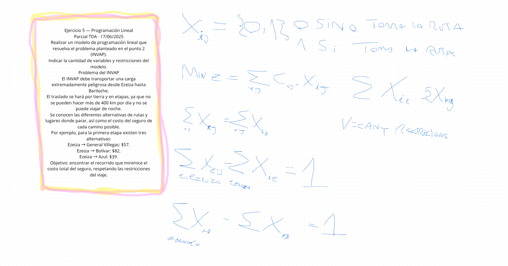

Ejercicio 5 de 5 — Programación Lineal
PARCIAL TDA · 17/06/2025 · Consigna original
Realizar un modelo de programación lineal que resuelva el problema planteado en el punto 2 o en el punto 4.

Indicar la cantidad de variables y restricciones del modelo.

Podés elegir entre:
1. INVAP: transportar una carga desde Ezeiza hasta Bariloche, minimizando el costo total del seguro y respetando las etapas permitidas.
2. 8 reinas: ubicar ocho reinas en un tablero sin que compartan fila, columna ni diagonal.
Mi recomendación es elegir INVAP, porque ya trabajaste con variables de decisión para rutas y conservación de flujo.

Seguimos como venimos haciendo: vos planteás las variables, la función objetivo y las restricciones. Yo solamente corrijo, sin pistas ni soluciones adelantadas.

